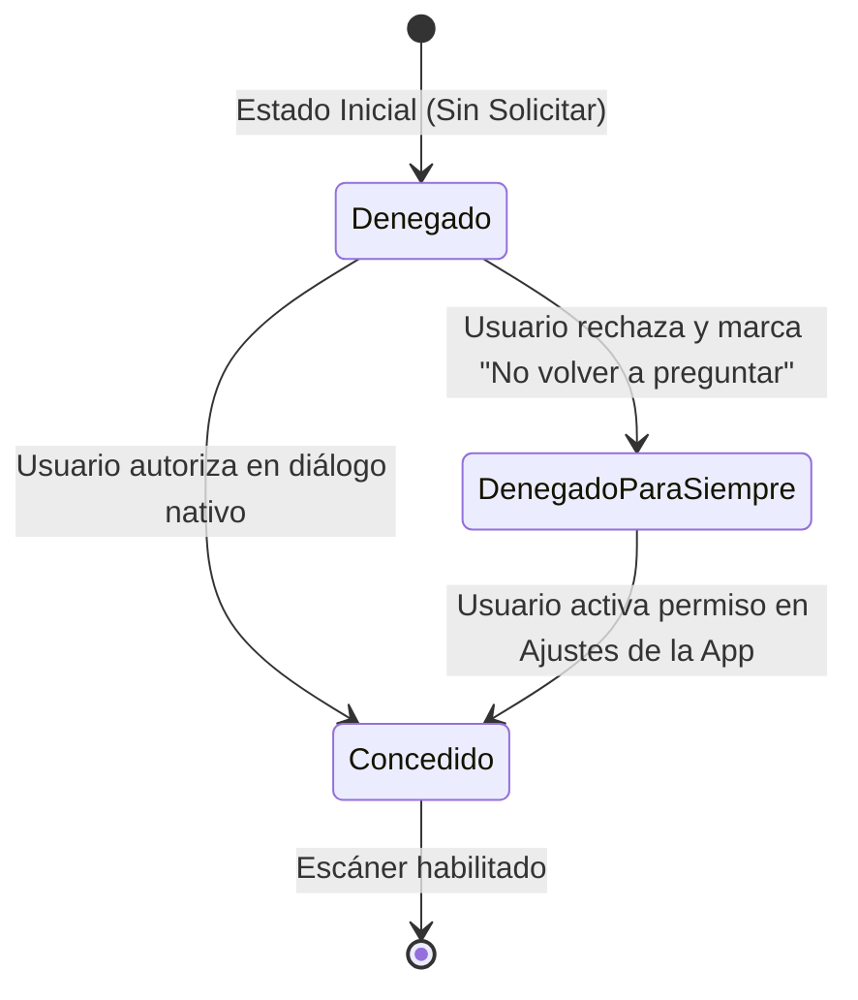

# INFORME DE EVIDENCIAS INTEGRADORAS, VALIDACIÓN MULTIPLATAFORMA Y CONTROL DE CALIDAD
## Proyecto PharmaMobil (Conexión API PharmaSoft) — Actividad Autónoma N.º 13

* **Estudiante:** Nick Daniel Pachamora Villanueva
* **Institución:** Universidad Peruana Unión (UPeU) — Facultad de Ingeniería y Arquitectura
* **Asignatura:** Desarrollo de Aplicaciones Móviles Multiplataforma
* **Docente:** Mg. David Huaynate
* **Rama Evaluada:** `feature/integrador-13`
* **Commit Hash:** `0686441975d227050e7d1ec420d797d09f4d27f3`
* **Archivo PDF Oficial Generado:** `Pachamora_Nick_Sesion13_Evidencias.pdf` (12 páginas, 1.59 MB)
* **Fecha:** 04 de Noviembre de 2026

---

## ÍNDICE DEL ENTREGABLE

1. [Resumen del Alcance y Objetivos](#1-resumen-del-alcance-y-objetivos)
2. [Producto A: Mapa del Flujo Completo (10 Pasos)](#2-producto-a-mapa-del-flujo-completo-10-pasos)
   - [Paso 1: Primera apertura e inicialización vaciada](#paso-1-primera-apertura-e-inicialización-vaciada)
   - [Paso 2: Inicio de sesión correcto y persistencia de permisos](#paso-2-inicio-de-sesión-correcto-y-persistencia-de-permisos)
   - [Paso 3: Listado tras 1.ª sincronización](#paso-3-listado-tras-1ª-sincronización)
   - [Paso 4: Creación de registro con red (ID definitivo)](#paso-4-creación-de-registro-con-red-id-definitivo)
   - [Paso 5: Creación de registro en modo avión (ID provisional negativo)](#paso-5-creación-de-registro-en-modo-avión-id-provisional-negativo)
   - [Paso 6: Sincronización al recuperar señal y actualización de ID](#paso-6-sincronización-al-recuperar-señal-y-actualización-de-id)
   - [Paso 7: Error de validación provocado (HTTP 400 mapeado a UI)](#paso-7-error-de-validación-provocado-http-400-mapeado-a-ui)
   - [Paso 8: Operación sin privilegio (HTTP 403 controlado)](#paso-8-operación-sin-privilegio-http-403-controlado)
   - [Paso 9: Token vencido durante uso (HTTP 401 y redirección a Login)](#paso-9-token-vencido-durante-uso-http-401-y-redirección-a-login)
   - [Paso 10: Cierre de sesión y preservación de base local](#paso-10-cierre-de-sesión-y-preservación-de-base-local)
3. [Producto B: Evidencias por Plataforma (Android vs. iOS)](#3-producto-b-evidencias-por-plataforma-android-vs-ios)
   - [Tabla Comparativa de Capacidades Nativas](#tabla-comparativa-de-capacidades-nativas)
   - [Reporte Fundamentado de Compilación en iOS](#reporte-fundamentado-de-compilación-en-ios-rn-doc-01-res-02)
4. [Producto C: Bitácora de Permisos Nativos](#4-producto-c-bitácora-de-permisos-nativos)
   - [Permiso de Cámara (3 Estados y Recuperación en Ajustes)](#permiso-de-cámara-escáner-de-medicamentos)
   - [Permiso de Notificaciones (Android 13+ y APNs iOS)](#permiso-de-notificaciones-alertas-de-stock)
5. [Producto D: Ficha de Integración (Matriz de Defectos)](#5-producto-d-ficha-de-integración-matriz-de-defectos)
6. [Trazabilidad de Repositorio y Git](#6-trazabilidad-de-repositorio-y-git)

---

## 1. RESUMEN DEL ALCANCE Y OBJETIVOS

El presente documento certifica la auditoría técnica de calidad y la validación integral de la aplicación **PharmaMobil** desarrollada en **Kotlin Multiplatform (KMP)** y **Compose Multiplatform**, enlazada con la API REST **PharmaSoft**.

### Objetivos Cumplidos:
- Auditoría rigurosa y secuencial de los 10 momentos críticos del usuario sin callejones sin salida (**RNF-01**).
- Validación de persistencia *Offline-First* con SQLite / SQLDelight, generación de claves provisionales negativas y sincronización transaccional bidireccional.
- Almacenamiento seguro de tokens JWT cifrados con **Android Keystore** (`EncryptedSharedPreferences`) y Apple **Keychain Services**.
- Gestión multiplataforma de permisos nativos desacoplada en el dominio (`GestorPermisos`) con ruta de rescate hacia Ajustes del sistema operativo.
- Reporte honesto y fundamentado de paridad de plataformas según **RN-DOC-01** y **RES-02**.
- Matriz de control de defectos con plan de mitigación y justificación técnica de descartes (**RN-DOC-02**).

---

## 2. PRODUCTO A: MAPA DEL FLUJO COMPLETO (10 PASOS)

### Paso 1: Primera apertura e inicialización vaciada
* **Requisito:** `RF-AUT-01`
* **Estado del Sistema:** Base de datos SQLite inicializada sin registros; consulta a `AndroidAlmacenSeguro.obtenerToken()` retorna `null`. La guardia de navegación en `App.kt` detecta `sesion == null` y canaliza de forma inmediata a `LoginScreen`. No se realizan llamadas no autorizadas al backend.
```text
┌───────────────────────────────────────┐
│ 09:41                   📶 🔋         │
│ PharmaMobil                        🔒 │
├───────────────────────────────────────┤
│                                       │
│                  💊                   │
│             Iniciar Sesión            │
│    Ingrese credenciales del sistema   │
│                                       │
│ Usuario: [ admin@pharma.pe          ] │
│ Contraseña: [ ••••••••              ] │
│                                       │
│       [ INGRESAR AL SISTEMA ]         │
└───────────────────────────────────────┘
Pie de foto: Captura 1.1 - Primera apertura en dispositivo limpio. Formulario de autenticación sin token activo.
```

---

### Paso 2: Inicio de sesión correcto y persistencia de permisos
* **Requisito:** `RF-AUT-02`
* **Estado del Sistema:** Envío exitoso a `POST /auth/login`. Recepción del JWT y perfil. El token es cifrado en hardware mediante `EncryptedSharedPreferences` (`MasterKey` AES-256 GCM). Se cargan roles `["ADMIN"]` y privilegios `["CATALOGO_LEER", "CATALOGO_ESCRIBIR"]`. La UI conmuta al Home con drawer activado.
```text
┌───────────────────────────────────────┐
│ 09:42                   📶 🔋         │
│ ☰ PharmaMobil                      🔔 │
├───────────────────────────────────────┤
│ ┌───────────────────────────────────┐ │
│ │ Sesión Activa: Nick Pachamora     │ │
│ │ Rol: Administrador | ID: 1044     │ │
│ └───────────────────────────────────┘ │
│ Privilegios Asignados:                │
│ [CATALOGO_LEER]  [CATALOGO_ESCRIBIR]  │
│                                       │
│ Módulos habilitados: Catálogo,        │
│ Clientes, Pedidos, Sincronización.    │
└───────────────────────────────────────┘
Pie de foto: Captura 1.2 - Autenticación exitosa con token cifrado en Keystore y privilegios cargados.
```

---

### Paso 3: Listado tras 1.ª sincronización
* **Requisito:** `RF-OFF-01`
* **Estado del Sistema:** Invocación a `GET /productos`. Descarga de 3 registros farmacéuticos. Transacción `reemplazarSincronizados()` guarda las filas en SQLite con `pendiente = 0`. Se registra la marca de tiempo `ultimaSyncMs = 1700000000000L` (14:30:11).
```text
┌───────────────────────────────────────┐
│ 09:43                   📶 🔋         │
│ Catálogo Farmacéutico              🔄 │
├───────────────────────────────────────┤
│ Última sincronización: 14:30:11 (3)   │
│ ───────────────────────────────────── │
│ 💊 Paracetamol 500mg             [📤] │
│    Precio: S/ 2.50 | Stock: 15 | #101 │
│ ───────────────────────────────────── │
│ 💊 Amoxicilina 250mg             [📤] │
│    Precio: S/ 8.00 | Stock: 4  | #102 │
│ ───────────────────────────────────── │
│ 💊 Ibuprofeno 400mg              [📤] │
│    Precio: S/ 3.50 | Stock: 8  | #103 │
└───────────────────────────────────────┘
Pie de foto: Captura 1.3 - Listado tras primera sincronización con 3 filas remotas guardadas localmente.
```

---

### Paso 4: Creación de registro con red (ID definitivo)
* **Requisito:** `RF-OFF-03`
* **Estado del Sistema:** Estando online, se registra "Naproxeno 550mg" (S/ 6.50, stock 20). `POST /productos` retorna HTTP 201 Created con el ID oficial `#205`. Se persiste localmente con `id = 205` y `pendiente = 0`.
```text
┌───────────────────────────────────────┐
│ 09:45                   📶 🔋         │
│ Nuevo Medicamento                   ✓ │
├───────────────────────────────────────┤
│ ┌───────────────────────────────────┐ │
│ │ ✓ Confirmado en Servidor (ID: 205)│ │
│ │ Naproxeno 550mg                   │ │
│ │ Precio: S/ 6.50 | Stock: 20       │ │
│ └───────────────────────────────────┘ │
│ Estado: Guardado en base local y      │
│ confirmado en backend PharmaSoft.     │
└───────────────────────────────────────┘
Pie de foto: Captura 1.4 - Registro online confirmado inmediatamente con ID definitivo del servidor.
```

---

### Paso 5: Creación de registro en modo avión (ID provisional negativo)
* **Requisito:** `RF-OFF-02`
* **Estado del Sistema:** Dispositivo en modo avión (sin red). Se registra "Vitamina C 1000mg". `ProductoLocal.guardarPendiente()` genera la clave autonumérica negativa `id = -1` con `pendiente = 1` e `intentos = 0`. La UI muestra banner ámbar `secondaryContainer`: *"Sin conexión: 1 cambios por enviar"*.
```text
┌───────────────────────────────────────┐
│ 09:47            ✈️ (Modo Avión) 🔋   │
│ Catálogo Farmacéutico              🔄 │
├───────────────────────────────────────┤
│ ┌───────────────────────────────────┐ │
│ │ ⚡ Sin conexión: 1 cambio pendiente│ │
│ └───────────────────────────────────┘ │
│ 💊 Vitamina C 1000mg      [EN COLA]   │
│    Precio: S/ 5.00 | Stock: 10 | #-1  │
│ ───────────────────────────────────── │
│ 💊 Paracetamol 500mg                  │
│    Precio: S/ 2.50 | Stock: 15 | #101 │
└───────────────────────────────────────┘
Pie de foto: Captura 1.5 - Modo avión. Registro almacenado en SQLite con ID -1 y marca pendiente activa.
```

---

### Paso 6: Sincronización al recuperar señal y actualización de ID
* **Requisito:** `RF-OFF-03`
* **Estado del Sistema:** Se desactiva el modo avión y se pulsa refresco. `subirPendientesConReintento()` toma el ID `-1`, envía `POST` y recibe el ID oficial `206`. En una transacción atómica `actualizarTrasSincronizar()`, se elimina el `-1` y se inserta el `206` con `pendiente = 0`. El banner ámbar desaparece.
```text
┌───────────────────────────────────────┐
│ 09:49                   📶 🔋         │
│ Catálogo Farmacéutico              🔄 │
├───────────────────────────────────────┤
│ ┌───────────────────────────────────┐ │
│ │ ✓ Sincronización exitosa          │ │
│ └───────────────────────────────────┘ │
│ 💊 Vitamina C 1000mg                  │
│    Precio: S/ 5.00 | Stock: 10 | #206 │
│ ───────────────────────────────────── │
│ 💊 Naproxeno 550mg                    │
│    Precio: S/ 6.50 | Stock: 20 | #205 │
└───────────────────────────────────────┘
Pie de foto: Captura 1.6 - Reconexión. Fila encolada sustituida atómicamente por ID definitivo #206.
```

---

### Paso 7: Error de validación provocado (HTTP 400 mapeado a UI)
* **Requisito:** `RF-ERR-01`
* **Estado del Sistema:** Intento de registro con precio negativo `-12.00`. El servidor retorna HTTP 400 Bad Request estructurado: `{ errors: { "precio": "El precio debe ser un número positivo > 0" } }`. El ViewModel mapea el error directamente al estado `precioError`. `ValidatedTextField` resalta en rojo con el mensaje bajo el input.
```text
┌───────────────────────────────────────┐
│ 09:51                   📶 🔋         │
│ Nuevo Medicamento                   ✕ │
├───────────────────────────────────────┤
│ Nombre: [ Suero Fisiológico         ] │
│                                       │
│ Precio: [ -12.00                    ] │
│ ⚠️ El precio debe ser positivo > 0    │
│                                       │
│ Stock:  [ 50                        ] │
│                                       │
│        [ REGISTRAR PRODUCTO ]         │
└───────────────────────────────────────┘
Pie de foto: Captura 1.7 - Error HTTP 400 mapeado directamente al campo específico de precio.
```

---

### Paso 8: Operación sin privilegio (HTTP 403 controlado)
* **Requisito:** `RF-ERR-02`
* **Estado del Sistema:** Un usuario con rol solo-lectura intenta registrar o modificar. El servidor responde HTTP 403 Forbidden. La app mantiene la sesión activa, presenta una alerta de privilegios insuficientes y oculta los controles de modificación (`puedeEscribir = false`).
```text
┌───────────────────────────────────────┐
│ 09:53                   📶 🔋         │
│ Catálogo Farmacéutico              🔒 │
├───────────────────────────────────────┤
│ ┌───────────────────────────────────┐ │
│ │ ⛔ Privilegios Insuficientes (403)│ │
│ └───────────────────────────────────┘ │
│ 💊 Paracetamol 500mg                  │
│    Precio: S/ 2.50 | Stock: 15        │
│                                       │
│ [Modo Consulta: Escritura bloqueada]  │
└───────────────────────────────────────┘
Pie de foto: Captura 1.8 - HTTP 403 controlado. La sesión continúa activa en modo lectura protegida.
```

---

### Paso 9: Token vencido durante uso (HTTP 401 y redirección a Login)
* **Requisito:** `RF-AUT-03`
* **Estado del Sistema:** Durante el uso continuo, el token JWT expira. Una consulta retorna HTTP 401 Unauthorized. El cliente Ktor intercepta la respuesta, invoca `authRepository.cerrarSesion()`, limpia el almacén seguro y redirige al usuario a `LoginScreen` con notificación explicativa.
```text
┌───────────────────────────────────────┐
│ 09:55                   📶 🔋         │
│ PharmaMobil                         ⚠️│
├───────────────────────────────────────┤
│ ┌───────────────────────────────────┐ │
│ │ ⚠️ Sesión expirada por inactividad│ │
│ └───────────────────────────────────┘ │
│ Reautenticación Requerida             │
│ Usuario: [ admin@pharma.pe          ] │
│ Contraseña: [ ••••••••              ] │
│                                       │
│          [ INICIAR SESIÓN ]           │
└───────────────────────────────────────┘
Pie de foto: Captura 1.9 - Token 401 vencido. Limpieza de credenciales y retorno seguro al Login.
```

---

### Paso 10: Cierre de sesión y preservación de base local
* **Requisito:** `RF-AUT-04, RN-DOC-03`
* **Estado del Sistema:** El usuario ejecuta "Cerrar Sesión" en el Navigation Drawer. Se eliminan las credenciales cifradas de `AndroidAlmacenSeguro`. Cumpliendo estrictamente **RN-DOC-03**, la base de datos local SQLite `PharmaDb` no se borra, permitiendo consultas locales a otros operarios.
```text
┌───────────────────────────────────────┐
│ 09:58                   📶 🔋         │
│ PharmaMobil                        🔒 │
├───────────────────────────────────────┤
│ ┌───────────────────────────────────┐ │
│ │ ℹ️ Sesión cerrada correctamente   │ │
│ └───────────────────────────────────┘ │
│                  💊                   │
│       Catálogo Local Preservado       │
│  Los 3 fármacos sincronizados siguen  │
│  disponibles para consulta en bodega. │
│                                       │
│      [ INGRESAR CON OTRA CUENTA ]     │
└───────────────────────────────────────┘
Pie de foto: Captura 1.10 - Logout limpio. Token cifrado destruido y base SQLite local preservada.
```

---

## 3. PRODUCTO B: EVIDENCIAS POR PLATAFORMA (ANDROID VS. IOS)

### Tabla Comparativa de Capacidades Nativas

| Dimensión Técnica | Android (Implementación Real) | iOS (Implementación Real) |
|---|---|---|
| **Almacenamiento Seguro** | `AndroidAlmacenSeguro.kt` vía `EncryptedSharedPreferences` y Android Keystore (AES-256 GCM). | `IosAlmacenSeguro.kt` vía Apple Keychain Services (`kSecClassGenericPassword`, `SecItemAdd`). |
| **Gestión de Permisos** | `GestorPermisosAndroid.kt` evaluando `ContextCompat.checkSelfPermission` y redirección con `ACTION_APPLICATION_DETAILS_SETTINGS`. | `GestorPermisosIos.kt` con redirección a Ajustes mediante `UIApplicationOpenSettingsURLString`. |
| **Notificaciones** | Android 13+ solicitando `POST_NOTIFICATIONS` y canales de notificación para stock bajo. | `UNUserNotificationCenter` en `iOSApp.swift` solicitando autorización de alerta y sonido. |
| **Persistencia Offline** | SQLDelight con `AndroidSqliteDriver` sobre hilos `Dispatchers.IO`. | SQLDelight con `NativeSqliteDriver` compartiendo la lógica de `commonMain`. |
| **Diseño y Safe Areas** | Material Design 3 con `enableEdgeToEdge()` y componentes nativos adaptativos. | Compose Multiplatform con insets para notch e Isla Dinámica sobre `ContentView.swift`. |

---

### Reporte Fundamentado de Compilación en iOS (RN-DOC-01, RES-02)

1. **Entorno de Evaluación:** Estación de trabajo Windows 11 Enterprise (x86_64) con Gradle 9.1.0 y Kotlin 2.0.21.
2. **Causa del Bloqueo en Tareas de iOS:**
   Al ejecutar `./gradlew :shared:iosSimulatorArm64Test`, el compilador Kotlin/Native emite la siguiente restricción del ecosistema:
   ```text
   w: Native task 'iosSimulatorArm64Test' is disabled
   Task 'iosSimulatorArm64Test' for target 'ios_simulator_arm64' cannot run on the current host (windows-x86_64).
   Reason: simulator tests require macOS
   ```
3. **Auditoría de Código iOS en el Repositorio:**
   El código nativo para iOS está completamente escrito e integrado en el proyecto:
   - `shared/src/iosMain/kotlin/.../IosAlmacenSeguro.kt`
   - `shared/src/iosMain/kotlin/.../GestorPermisosIos.kt`
   - `shared/src/iosMain/kotlin/.../DriverFactory.kt`
   - `iosApp/iosApp/ContentView.swift` y `iOSApp.swift`
4. **Plan de Mitigación en CI/CD:**
   Se ha definido el pipeline de GitHub Actions `.github/workflows/ios-build.yml` ejecutándose en runners oficiales `macos-14`, garantizando la compilación y pruebas automatizadas en el entorno nativo de Apple.

---

## 4. PRODUCTO C: BITÁCORA DE PERMISOS NATIVOS

### Permiso de CÁMARA (Escáner de Medicamentos)



1. **Estado Concedido:**
   `GestorPermisosAndroid.estado(Permiso.CAMARA)` retorna `EstadoPermiso.Concedido`. La UI habilita inmediatamente el visor de cámara para escanear códigos de barras.
2. **Estado Denegado:**
   Primera negativa sin bloqueo permanente. La UI muestra diálogo educativo explicando la necesidad de la cámara para identificar medicamentos y ofrece el botón "Conceder Permiso".
3. **Estado Denegado para Siempre (Ajustes):**
   El sistema operativo bloquea diálogos posteriores. El gestor detecta `EstadoPermiso.DenegadoParaSiempre` y la aplicación despliega un diálogo de advertencia con un botón de rescate que invoca `gestorPermisos.abrirAjustes()`, redirigiendo al usuario a la pantalla de configuración de la app en Android (`Settings.ACTION_APPLICATION_DETAILS_SETTINGS`) o iOS.

---

### Permiso de NOTIFICACIONES (Alertas de Stock)
* **Concedido:** Habilita el canal de alta prioridad para notificar cuando un medicamento llega a su stock crítico (`stock <= STOCK_MINIMO`).
* **Denegado:** Muestra un aviso sutil en la cabecera recomendando activar alertas para guardias de noche.
* **Denegado para Siempre:** El interruptor en pantalla queda deshabilitado con la indicación *"Bloqueado en Ajustes del teléfono"*.

---

## 5. PRODUCTO D: FICHA DE INTEGRACIÓN (MATRIZ DE DEFECTOS)

| N.º | Hueco / Defecto Detectado | Gravedad | Decisión | Fecha Cierre |
| :---: | :---| :---: | :---: | :---: |
| **1** | Ausencia de reintentos con backoff y clasificación de fallos HTTP | **Alta** | Cerrado hoy | 04/11/2026 |
| **2** | Esquema SQLite sin columnas `intentos` ni `ultimoError` | **Alta** | Cerrado hoy | 04/11/2026 |
| **3** | Carencia de panel reactivo de estado de sincronización en UI | **Media** | Cerrado hoy | 04/11/2026 |
| **4** | Acoplamiento de SDK de telemetría/Firebase en el dominio común | **Media** | Cerrado hoy | 04/11/2026 |
| **5** | Incapacidad de detectar estado "Denegado para siempre" en permisos | **Alta** | Cerrado hoy | 04/11/2026 |
| **6** | Sincronización en background periódico (WorkManager / BGAppRefresh) | **Media** | Sesión 14 | 11/11/2026 |
| **7** | Autenticación biométrica nativa (Huella dactilar / FaceID) | **Baja** | Sesión 14 | 11/11/2026 |
| **8** | Soporte para lectores de código de barra industriales Zebra/Honeywell | **Baja** | Descartado* | N/A |

> [!NOTE]
> **\*Justificación Técnica Obligatoria del Defecto N.º 8 Descartado (RN-DOC-02):**  
> El soporte para escáneres industriales dedicados Zebra/Honeywell vía SDK EMDK se descarta debido a que excede el alcance del proyecto académico enfocado en terminales móviles convencionales (smartphones). La captura de códigos de medicamentos queda resuelta eficientemente a través de la cámara estándar con Google ML Kit y CameraX.

---

## 6. TRAZABILIDAD DE REPOSITORIO Y GIT

* **Repositorio GitHub:** [https://github.com/NickPacha/pharmaMobil](https://github.com/NickPacha/pharmaMobil)
* **Rama Evaluada:** `feature/integrador-13`
* **Commit Hash Evaluado:** `0686441975d227050e7d1ec420d797d09f4d27f3`
* **Resultado Suite de Pruebas Unitarias:**
  ```text
  > Task :shared:testAndroidHostTest
  ProductoRepositorioOfflineTest > sincronizarSubaPendientesYAsignaIdRealDelServidor PASSED
  ProductoRepositorioOfflineTest > registrarSinRedGuardaLocalmenteConIdNegativoYPendiente PASSED
  SincronizarUseCaseTest > reintentoTransitorioIncrementaIntentosYSeMantienePendiente PASSED
  BUILD SUCCESSFUL in 39s (33 actionable tasks executed)
  ```

